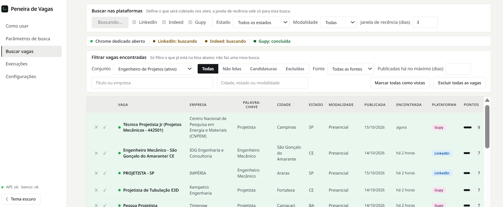
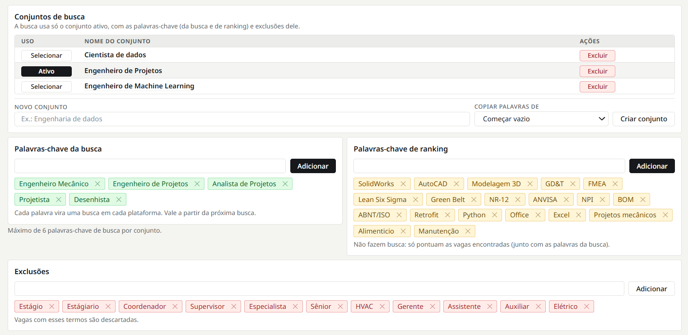

# Peneira de Vagas

Busca vagas no **LinkedIn**, no **Indeed** e na **Gupy**, filtra pelas suas palavras-chave, remove duplicadas e
mostra só as novas. Roda **local**, na sua máquina.





## Instalar

No PowerShell (Windows), uma única vez. Não precisa de Python nem de administrador:

```powershell
irm https://raw.githubusercontent.com/marcos-moraesjr/peneira-de-vagas/main/scripts/install.ps1 | iex
```

Depois, em um terminal novo:

| Comando | O que faz |
| --- | --- |
| `peneira` | abre a interface no navegador (Ctrl+C encerra) |
| `peneira atualizar` | instala a versão mais nova (a tela avisa quando houver) |
| `peneira desinstalar` | remove o programa; seus dados ficam |

Requer o **Google Chrome** para LinkedIn e Indeed (a Gupy funciona sem ele).

## Usar

1. Em **Palavras-chave**, adicione os termos de busca. Use **Exclusões** para descartar o que não interessa.
2. Para LinkedIn e Indeed: clique em **Abrir Chrome dedicado** e faça login nos dois **à mão**, nessa janela. Deixe-a aberta durante a busca.
3. Clique em **Buscar agora** e acompanhe o andamento por fonte.
4. Abra as vagas novas pelo link e marque como vistas. A tela **Execuções** mostra o histórico e o motivo de qualquer falha.

O Chrome dedicado usa um perfil próprio, nunca o seu pessoal. Se aparecer CAPTCHA ou verificação, resolva à mão:
o projeto não contorna bloqueios.

> Usar navegador logado em automação pode violar os termos de uso do LinkedIn e do Indeed. O risco de restrição
> da conta é seu.

## Seus dados

Ficam na sua máquina, em `%LOCALAPPDATA%\PeneiraDeVagas` (banco, `config.toml`, logs e perfil do Chrome). A
aplicação só fala com as três fontes de vagas e, para avisar de atualização, consulta a última versão no GitHub
(só a versão, nenhum dado seu). Para desligar essa consulta: `verificar = false` em `[atualizacao]` no `config.toml`.

## Desenvolvimento

Requer Python 3.12+, Node.js 20+ e Google Chrome. O projeto não baixa navegadores do Playwright.

```bash
python -m venv .venv
.venv\Scripts\activate                 # Linux/macOS: source .venv/bin/activate
pip install -r backend/requirements.txt
cd frontend && npm install && npm run build && cd ..

.venv\Scripts\python -m uvicorn backend.app.main:create_app --factory --host 127.0.0.1 --port 8100
```

Abra <http://127.0.0.1:8100>. Para desenvolver o front com recarga: `cd frontend && npm run dev`
(<http://127.0.0.1:5173>, com proxy para a API).

- Não use `--reload` em buscas reais no Windows: o recarregador impede o Playwright de conectar ao Chrome.
- Não exponha a API além de `127.0.0.1`: ela não tem autenticação.
- Após mudar um schema da API: `python -m backend.scripts.export_openapi` e `cd frontend && npm run gen:api`.

Testes (sem rede):

```bash
pytest                              # backend, a partir da raiz
cd frontend && npm test             # front
cd frontend && npm run typecheck    # tipos
```

Os testes contra os sites reais (`pytest -m integration`) são rodados só por você, à mão.

Gerar o pacote de instalação: `powershell -File scripts\build-release.ps1 -Versao X.Y.Z`, e publicar com
`gh release create vX.Y.Z release\peneira.zip`.

## Documentação

| Doc | Conteúdo |
| --- | --- |
| [`docs/ARCHITECTURE.md`](docs/ARCHITECTURE.md) | escopo, regras de negócio, fluxo, API, módulos, dados e configuração |
| [`docs/SCANNERS.md`](docs/SCANNERS.md) | exploração das plataformas, versão dos scanners e o que fazer quando um quebra |
| [`docs/TECH_STACK.md`](docs/TECH_STACK.md) · [`docs/CODE_QUALITY.md`](docs/CODE_QUALITY.md) | bibliotecas, testes, estilo e git |
| [`docs/DESIGN_BRIEF.md`](docs/DESIGN_BRIEF.md) | telas da interface |
| [`docs/LESSONS.md`](docs/LESSONS.md) | erros e lições registrados |
| [`docs/AI_GUIDELINES.md`](docs/AI_GUIDELINES.md) | regras para agentes de IA |
